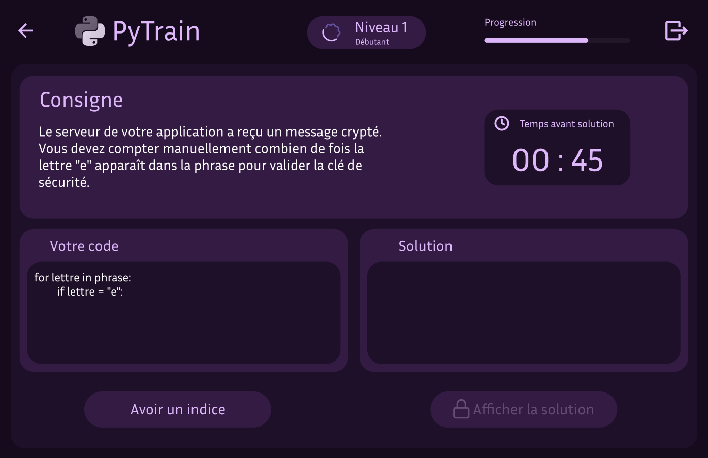

# 🐍 Python Learning Mobile App - UI/UX Prototype

> A user-centered mobile application designed to make learning Python intuitive, engaging, and accessible for beginners. 

## 📱 About the Project
This project is a comprehensive UI/UX design and interactive prototype for a mobile application dedicated to learning Python programming. Built with a strong focus on **cognitive ergonomics** and user engagement, the app breaks down complex programming concepts into bite-sized, interactive learning modules with gamified challenges.

## 🎯 Key Features
* **Interactive Code Playground:** Practice syntax and run code snippets directly within a mobile-optimized interface.
* **Bite-Sized Lessons:** Structured learning paths ranging from basic variables to object-oriented programming (OOP).
* **Gamified Progress:** Earn streaks, unlock achievements, and track daily learning habits to maintain motivation.
* **Adaptive Learning:** Tailored exercises based on user performance and cognitive load theory.

## 🛠️ Design & Methodology
* **Tool:** Figma (Wireframes, Design System, Interactive Prototypes)
* **Approach:** User-Centered Design (UCD), Card Sorting, and Usability Heuristics.
* **Accessibility:** Designed with a clean, high-contrast interface adhering to WCAG guidelines to ensure readability and ease of use.

## 👤 Author
* **Nassim Nancib** - *UI/UX Designer & Cognitive Science Student*
